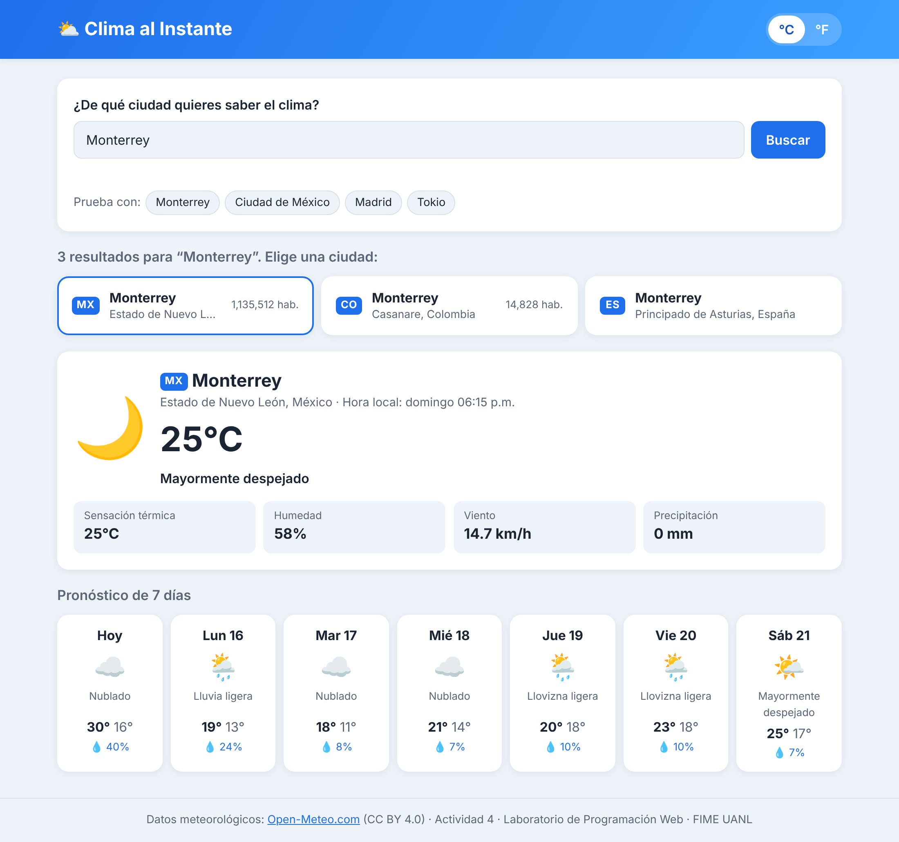
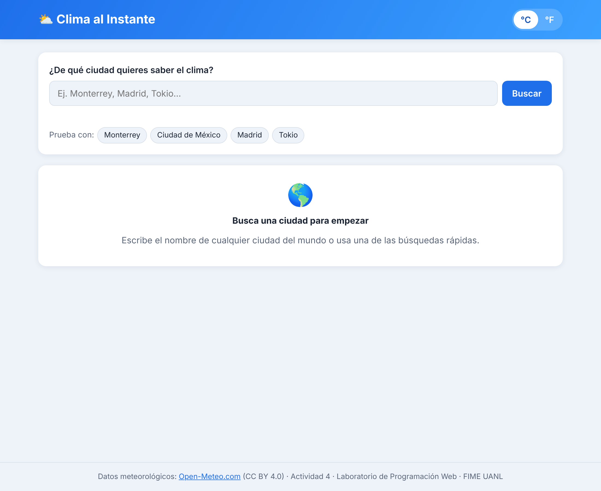
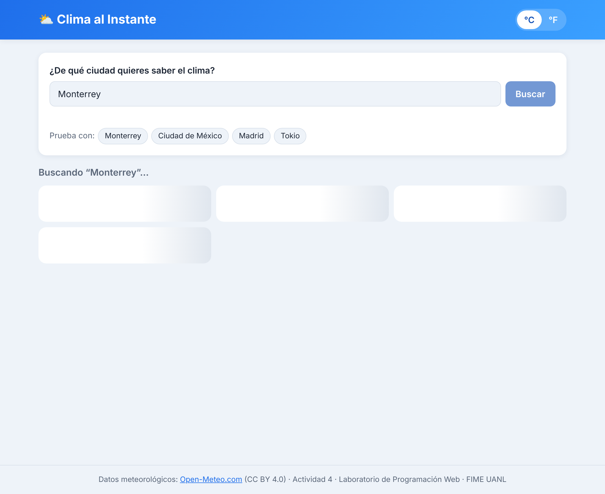
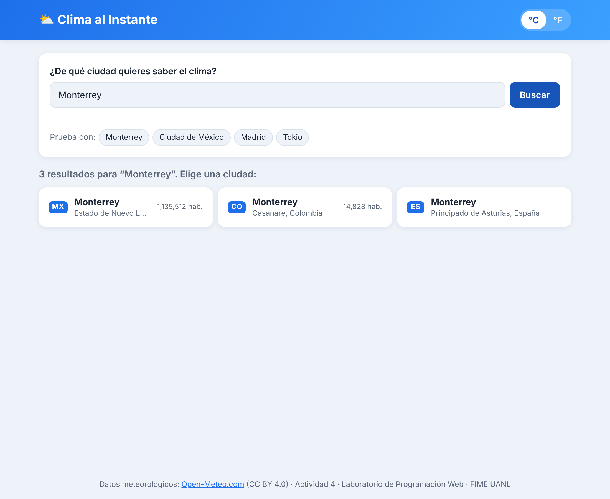
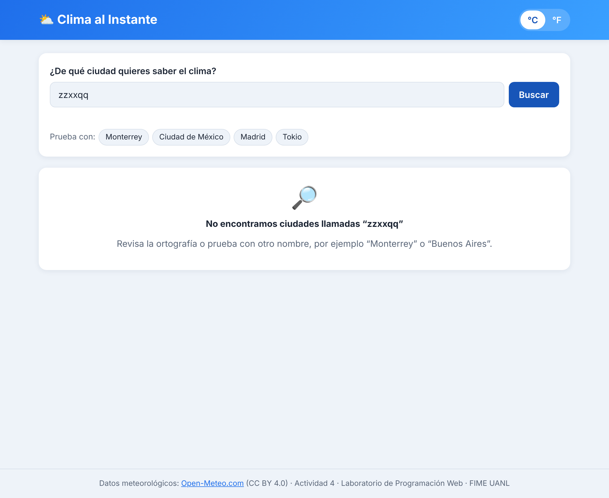
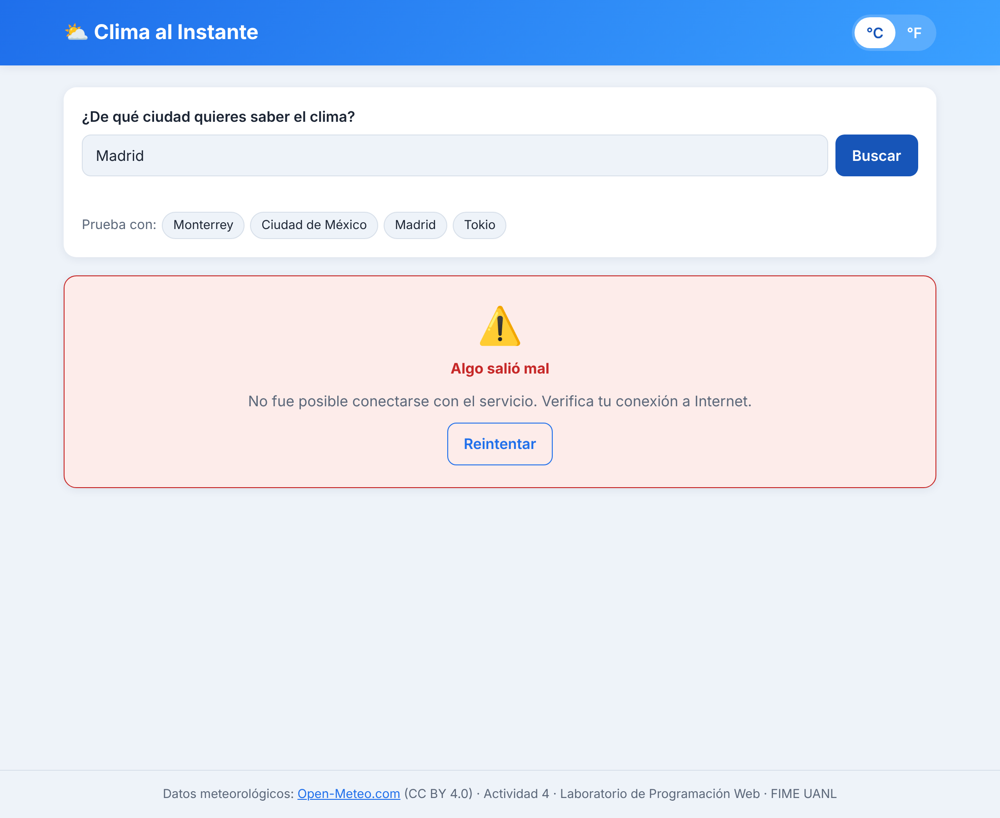
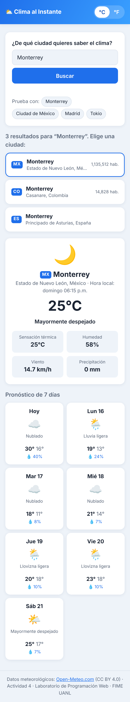

# ⛅ Clima al Instante

Miniaplicación web que consulta el **clima actual y el pronóstico de 7 días** de cualquier ciudad del mundo consumiendo la API REST pública de **[Open-Meteo](https://open-meteo.com/)**, con `fetch()` y `async/await`, sin API keys ni datos sensibles.

> **Actividad 4.** Miniaplicación web consumiendo una API REST · Laboratorio de Programación Web · FIME UANL
> Alumno: Leonardo Dávila Góngora (2145945) · Grupo 406 · Docente: Laura Patricia del Bosque Vega

- 🌐 **Aplicación publicada:** https://leyesdavila.github.io/clima-al-instante/
- 📦 **Repositorio:** https://github.com/leyesdavila/clima-al-instante



---

## 1. La API seleccionada: Open-Meteo

Open-Meteo es un servicio meteorológico abierto que combina modelos de pronóstico de varios institutos nacionales. Se eligió porque:

- Es **gratuita para uso no comercial** y **no requiere registro ni API key** (no hay credenciales que proteger en el código del cliente).
- Permite **CORS**, así que puede llamarse directamente desde el navegador.
- Responde en **JSON** y está bien documentada.

> Nota: al inicio se evaluó *REST Countries*, pero sus versiones v1–v4 fueron dadas de baja y la v5 ahora exige una API key, por lo que no cumplía el requisito de la actividad.

La aplicación usa **dos endpoints**:

### 1.1 Geocoding API — buscar ciudades

```
GET https://geocoding-api.open-meteo.com/v1/search
```

| Parámetro  | Valor usado | Descripción |
|------------|-------------|-------------|
| `name`     | texto del usuario | Nombre (o parte) de la ciudad. Mínimo 2 caracteres. |
| `count`    | `10`        | Número máximo de resultados. |
| `language` | `es`        | Idioma de los nombres de país y estado. |
| `format`   | `json`      | Formato de respuesta. |

Ejemplo: `https://geocoding-api.open-meteo.com/v1/search?name=Monterrey&count=10&language=es&format=json`

```json
{
  "results": [
    {
      "id": 3995465,
      "name": "Monterrey",
      "latitude": 25.68435,
      "longitude": -100.31721,
      "country_code": "MX",
      "timezone": "America/Monterrey",
      "population": 1135512,
      "country": "México",
      "admin1": "Estado de Nuevo León"
    }
  ],
  "generationtime_ms": 0.11
}
```

⚠️ Si no hay coincidencias, la API responde `200 OK` **sin** la propiedad `results` (`{"generationtime_ms": 0.06}`). La app lo detecta y muestra el estado vacío.

### 1.2 Forecast API — clima actual y pronóstico

```
GET https://api.open-meteo.com/v1/forecast
```

| Parámetro          | Valor usado | Descripción |
|--------------------|-------------|-------------|
| `latitude`, `longitude` | de la ciudad elegida | Coordenadas WGS84. |
| `current`          | `temperature_2m, relative_humidity_2m, apparent_temperature, is_day, precipitation, weather_code, wind_speed_10m` | Variables del momento actual. |
| `daily`            | `weather_code, temperature_2m_max, temperature_2m_min, precipitation_probability_max` | Variables por día. |
| `timezone`         | `auto`      | Fechas en la hora local de la ciudad. |
| `forecast_days`    | `7`         | Días de pronóstico. |
| `temperature_unit` | `celsius` / `fahrenheit` | Según el botón °C/°F. |
| `wind_speed_unit`  | `kmh`       | Velocidad del viento en km/h. |

Respuesta (resumida):

```json
{
  "timezone": "America/Monterrey",
  "current_units": { "temperature_2m": "°C", "relative_humidity_2m": "%", "wind_speed_10m": "km/h" },
  "current": {
    "time": "2026-11-15T18:15", "temperature_2m": 25.1, "relative_humidity_2m": 58,
    "apparent_temperature": 25.1, "is_day": 0, "precipitation": 0.0,
    "weather_code": 1, "wind_speed_10m": 14.7
  },
  "daily": {
    "time": ["2026-11-15", "2026-11-16", "..."],
    "weather_code": [3, 61, "..."],
    "temperature_2m_max": [29.7, 19.3, "..."],
    "temperature_2m_min": [16.2, 13.1, "..."],
    "precipitation_probability_max": [40, 24, "..."]
  }
}
```

`weather_code` es un código **WMO** (0 = despejado, 61 = lluvia ligera, 95 = tormenta…); la tabla de traducción a español e ícono está en [`js/codigos-clima.js`](js/codigos-clima.js).

### 1.3 Códigos de respuesta y errores

| Situación | Respuesta de la API | Qué muestra la app |
|-----------|--------------------|--------------------|
| Éxito | `200` + JSON | Resultados / pronóstico |
| Sin coincidencias | `200` sin `results` | Estado vacío “No encontramos ciudades…” |
| Parámetro inválido | `400` + `{"error": true, "reason": "..."}` | Error con el motivo que da la API |
| Demasiadas peticiones | `429` | “Se hicieron demasiadas consultas seguidas…” |
| Falla del servidor | `5xx` | “El servicio de Open-Meteo no está disponible…” |
| Sin Internet / CORS | `fetch` rechaza la promesa | “No fue posible conectarse con el servicio…” |
| Más de 10 s sin respuesta | `AbortController` cancela | “La consulta tardó demasiado…” |

Todos los errores muestran un botón **Reintentar**.

---

## 2. Instrucciones de uso

1. Abre la aplicación: **https://leyesdavila.github.io/clima-al-instante/**
2. Escribe el nombre de una ciudad (mínimo 2 letras) y presiona **Buscar** o Enter. También puedes usar las búsquedas rápidas (*Monterrey, Ciudad de México, Madrid, Tokio*).
3. Aparece la lista de ciudades que coinciden, con código de país, estado/país y población. **Elige una**.
4. Se muestra el clima actual (temperatura, sensación térmica, humedad, viento, precipitación y hora local) y el **pronóstico de 7 días**.
5. Con el interruptor **°C / °F** de la esquina superior cambias la unidad; la app vuelve a consultar la API y recuerda tu preferencia.

### Ejecutarla localmente

No necesita instalación ni dependencias. Como usa módulos ES (`type="module"`), debe servirse por HTTP (no abriendo el archivo con doble clic):

```bash
git clone https://github.com/leyesdavila/clima-al-instante.git
cd clima-al-instante
python -m http.server 8000      # o: npx serve .   /  extensión Live Server de VS Code
# abrir http://localhost:8000
```

---

## 3. Estructura del proyecto

```
clima-al-instante/
├── index.html            # Estructura semántica + <template> de los componentes
├── css/styles.css        # Estilos responsivos, modo oscuro, animaciones de carga
├── js/
│   ├── app.js            # Punto de entrada: eventos y estado de la aplicación
│   ├── api.js            # Cliente REST: fetch + async/await, timeout, errores
│   ├── ui.js             # Componentes del DOM y estados de carga / vacío / error
│   └── codigos-clima.js  # Códigos WMO → descripción en español + ícono
└── docs/capturas/        # Capturas de pantalla para este README
```

**Flujo:** `app.js` recibe la acción del usuario → llama a `api.js` (`buscarCiudades` / `obtenerPronostico`) → `api.js` hace el `fetch`, valida el `status` y convierte a JSON → `ui.js` crea los elementos en el DOM a partir de los `<template>` del HTML.

---

## 4. Capturas de pantalla

| Inicio | Cargando (esqueleto) |
|---|---|
|  |  |

| Resultados de búsqueda | Clima y pronóstico |
|---|---|
|  |  |

| Sin resultados (estado vacío) | Error de conexión |
|---|---|
|  |  |

Vista en celular:



---

## 5. Reflexión técnica

**Asincronía.** Toda la comunicación con la API pasa por una sola función, `obtenerJSON()`, escrita con `async/await`. Esto hace que el código se lea de arriba hacia abajo como si fuera síncrono, y que los errores se manejen con un `try/catch` normal en lugar de cadenas de `.then().catch()`. Aprendí que `fetch` **solo rechaza la promesa cuando falla la red**: un `404` o un `500` llegan como respuestas “exitosas”, así que siempre hay que revisar `response.ok` antes de usar los datos.

**Robustez.** Se usa `AbortController` para dos cosas: poner un tiempo límite de 10 s y cancelar una búsqueda anterior si el usuario hace otra antes de que termine (evita que una respuesta lenta “pise” a una más reciente). También descubrí un detalle de la API que no está muy visible en la documentación: cuando no hay coincidencias, no regresa una lista vacía sino que omite la propiedad `results`; por eso se valida con `Array.isArray()`.

**Presentación de datos.** Los componentes se crean a partir de elementos `<template>` del HTML y se llenan con `textContent`, nunca con `innerHTML`, para que ningún texto que venga del servicio externo pueda inyectar HTML. Los datos crudos se transforman antes de mostrarse: códigos WMO a texto e ícono, números con `Intl.NumberFormat` y fechas con `toLocaleDateString('es-MX')`.

**Experiencia de usuario.** Cada consulta tiene tres estados además del exitoso: **carga** (tarjetas esqueleto y spinner, con `aria-busy`), **vacío** (mensaje con sugerencias) y **error** (mensaje comprensible según el tipo de falla y botón *Reintentar*). Esto es justo lo que pide la situación de trabajo: integrar datos externos sin que el usuario tenga que capturarlos y sin dejarlo con una pantalla en blanco cuando algo falla.

**Comparación con XML.** Frente a la práctica original basada en XML, JSON se convierte directamente en objetos de JavaScript con `response.json()`; no hace falta `DOMParser` ni recorrer nodos, lo que reduce mucho el código.

**Mejoras posibles:** guardar ciudades favoritas, autocompletar mientras se escribe (con *debounce*), usar la geolocalización del navegador y mostrar una gráfica horaria.

---

## 6. Control de versiones y despliegue

- El historial de commits refleja cada etapa: estructura, cliente de la API, componentes, interacción y documentación.
- Publicado con **GitHub Pages** desde la rama `main` (carpeta raíz).

## Créditos

Datos meteorológicos de [Open-Meteo.com](https://open-meteo.com/), licencia [CC BY 4.0](https://creativecommons.org/licenses/by/4.0/).
